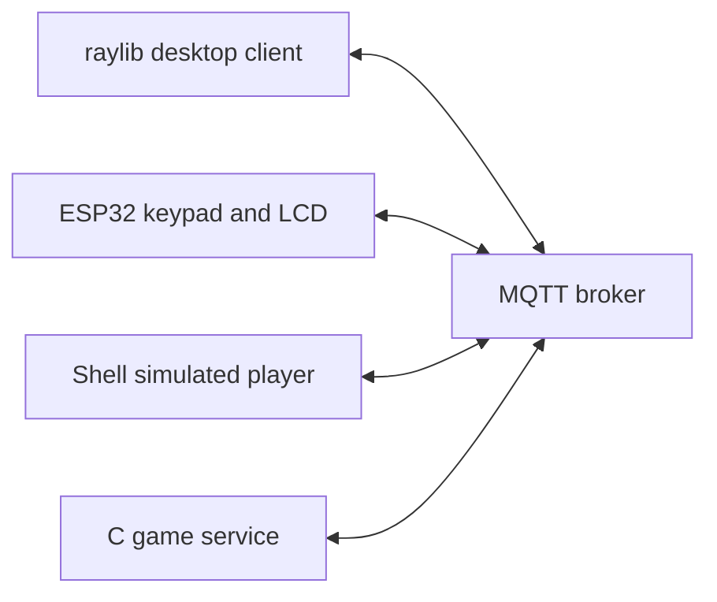

# MQTT Tic-Tac-Toe

A CS2600 coursework project with a C game service, a raylib desktop client, an ESP32 keypad and LCD client, and a shell-based simulated player. Clients and the game service exchange moves, board updates, mode, and status over MQTT.

## Build

- Compile the game service with `cc codeGCP.c -o game-service -lmosquitto` after installing the Mosquitto client library and headers.
- Build the desktop client against Mosquitto and raylib. On a system with both pkg-config packages installed, use `cc laptopGUI.c -o desktop-client $(pkg-config --cflags --libs libmosquitto raylib)`.
- Install the ESP32 Arduino board platform and the PubSubClient, Keypad, and LiquidCrystal_I2C libraries. Open the sketch in Arduino IDE and keep both header files beside the sketch after creating the local header.
- Install the Mosquitto command-line clients to run the simulated player.

## Configure and run

1. Copy `wifi_secrets.example.h` to `wifi_secrets.h` and fill in the local Wi-Fi settings. The local header is ignored by Git. If Arduino IDE moves the sketch to a same-named directory, keep the header with the sketch and confirm Git still ignores it.
2. Point each component at the same isolated test broker. Review each component's broker host and port constants before starting it. The desktop and game service currently use different default ports.
3. Start the broker and C game service. Use the desktop and ESP32 clients or the simulated player to make moves. Verify that both participants see the same board and final game status.

## Known limitations

The reviewed MQTT clients use plain connections. Keep the demo on an isolated broker and network. The repository does not include an end-to-end automated test.
